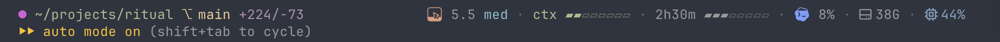

# plimsoll

A status line for [Claude Code](https://claude.com/claude-code), and for Codex when it works
alongside. One bash script, plus a small icon font built on your machine. Named after the
Plimsoll line, the mark on a ship's hull that shows how much more load she can take: its icons
drain as your usage limits are spent.

**Status**: in daily use on one machine; other terminals than Ghostty are untested.
**Stack**: bash and `jq`; the font is built by a Swift script with CoreGraphics.
**Platform**: macOS; the icons need macOS 14 or later.

---

## What it looks like



The first row is plimsoll; the second is Claude Code's own. On the left: a dot coloured per
session, so two sessions in one project tell apart, then the path, the branch and the
uncommitted diff. On the right:

- **Model**, with its version, effort level and ⚡ in fast mode. The family is drawn as a tile
  filled to what is left of the weekly limit; clicking it opens the usage page.
- **ctx**: the context window, 8 cells, each lit as soon as any of it is used. Yellow from 50%,
  red from 80%.
- **The five-hour limit**: time to its reset, then the bar. Yellow from 70%, red from 90%; once
  only the last cell remains, what is left follows as a number.
- **Codex**: its mark filled to its weekly limit, and the share of its five-hour window used,
  read from Codex's own session logs. Dimmed when the reading is over an hour old.
- **Free disk space**, yellow under 25 GB and red under 10, and **CPU**, the average load
  across all cores.

Every part is called out on the screenshot on the [project page](https://tigeneric.github.io/plimsoll/).

## Why

Claude Code knows the numbers that decide how a session goes — how full the context is, how
much of the five-hour and weekly limits is left — and shows them only when asked. The status
line is the one place that is always on screen, and it is narrow: a number per limit does not
fit, and a number is read rather than glanced at. A tile that drains is glanced at.

## Installing

Needs `jq`, which comes with macOS from 15; on macOS 14 install it first (`brew install jq`).
The icons are built by Swift from the Command Line Tools — the package `git` comes from, so if
`git` works you have it; otherwise macOS offers to install it the first time you run
`git clone`. Nothing else is installed.

```bash
git clone https://github.com/Tigeneric/plimsoll.git
plimsoll/install.sh            # or --no-font for names only
```

`install.sh` links `~/.claude/statusline.sh` to the clone, sets Claude Code's `statusLine` if
none is set (an existing one is left alone), builds and installs the font, and prints the
terminal configuration line when it is missing. Running it again is safe; it is also how an
update is applied after `git pull`.

## Configuring

The icons are glyphs at private-use code points U+E900–U+E9A9, and the terminal has to draw
those code points from the font:

- **Ghostty** (and cmux, built on it): one line, which `install.sh` prints —
  `font-codepoint-map = U+E900-U+E9A9=Statusline Icons <N>`. Detected automatically.
- **Other terminals**: kitty's `symbol_map`, WezTerm's font fallback list or VS Code's
  `terminal.integrated.fontFamily` can map the font; then set `STATUSLINE_ICONS=1` in the
  environment Claude Code runs in. Each glyph is drawn two cells wide over the space after it,
  which some terminals clip.

Without the mapping, or with `STATUSLINE_ICONS=0`, the line prints the names — `Opus 5.5`,
`Codex 8%` — and the weekly limits are not shown.

**The pictures are not in this repository.** The model icons are Anthropic's illustrations
from its model documentation, and the Codex mark is OpenAI's. `fonts/build.swift` downloads them
from their public URLs when you build, checks each against a recorded SHA-256, and draws the
tiles on your machine. This project is not affiliated with Anthropic or OpenAI.

### In cmux

cmux draws with Ghostty and reads the same configuration, so the one `font-codepoint-map` line
covers it too. Restart cmux after installing a new font version: a running cmux keeps the face
it has loaded.

The model and Codex marks are links to their usage pages, and in cmux a plain click opens the
page in its built-in browser, in a pane beside the session — the limit's details are one click
from the line that shows it. Other terminals that support OSC 8 links usually want ⌘-click and
open the system browser.

## How it is put together

| File | Does |
|---|---|
| `statusline.sh` | Reads Claude Code's status JSON on stdin, prints the line |
| `fonts/build.swift` | Downloads the pictures, builds `StatuslineIcons.otf`: 5 marks × 26 fill levels, cut with CoreGraphics and written as CFF outlines |
| `install.sh` | Link, setting, font, terminal check |
| `tests/run.sh` | The line's output in a throwaway `$HOME`, and the code point layout |

```bash
make test       # what CI runs
make font       # rebuild the font
```

The code point layout is written twice, in `fonts/build.swift` and in `icon_glyph()` in
`statusline.sh`, and the tests check that the two agree. The font's family name carries a
version (`family` in `build.swift`): bump it on every glyph change, since a running terminal keeps
the face it has loaded under the old name.

## Licence

MIT for the code in this repository — see [LICENSE](LICENSE). The downloaded pictures remain
their owners'.
